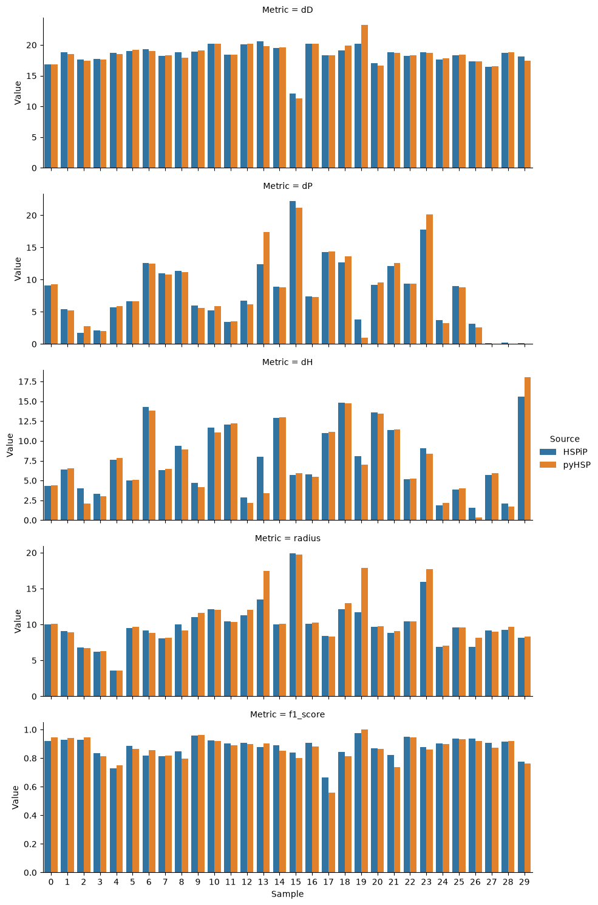

# pyHSP
pyHSP is a python package for performing fitting of Hansen Solubility Parameters.

## About Hansen Solubility Parameters (HSP)
[Hansen Solubility Parameters](https://en.wikipedia.org/wiki/Hansen_solubility_parameter) provide a methodology for predicting the solubility of a solute in one or more solvents based upon 3 terms, or dimensions, covering dispersion, polar and hydrogen bonding forces; for simplicity we term these dD, dP, and dH respectively. Every chemical has characteristic set of solubility parameters, defining a point in the parameter space. A solute is likely to dissolve in a solvent when the (modified) euclidean distance in the parameter space is small (like dissolves like). A cut-off distance determines if a solute is soluble or not. This is termed the 'solubility radius', as together with the dD, dP, dH terms it defines a solubility sphere.

Determining the solubility parameters of a solute is done experimentally. Dissolution trials are conducted in solvents with known solubility parameters, then each sample scored 1 for dissolved, or 0 for not dissolved. We recommend testing at least 12 different solvents. The acquired data is used to fit a sphere that attempts to accurately classify the trialled solvents. With a fitted sphere predictions can be made about the solute solubility in other solvents.

HSP has traditionally been applied to polymers, but has been successfully applied to pigments, dispersions and small molecules.

## About pyHSP
The fit and predict method of HSP aligns with machine learning, specifically classification. pyHSP implements a scikit-learn compatible API for fitting solubility spheres. pyHSP has been developed to introduce an alternative fitting strategy and (in the future) provide support for improvements proposed by [Louwerse et al.](https://chemistry-europe.onlinelibrary.wiley.com/doi/full/10.1002/cphc.201700408)

### Roadmap
- [x] Sphere fitting using classic Hansen distance
- [] Support for donor/acceptor split hydrogen bonding term
- [] Support for Louwerse et al. improvements
- [] Visualisation

### License
This software is licensed under the MIT license.

## Installation
Eager beavers can check out the repository.

## Usage
The main entry point is the `ClassicSphere` class, which is a scikit-learn classifier:
```
from pyHSP import ClassicSphere

X = ...  # a 2D array-like of trial solvent HSPs, ordered dD, dP, dH
y = ... # solubility scores for each trial solvent; 1 = soluble, 0 = insoluble

sphere = ClassicSphere().fit(X, y)

# Fitted solubility parameters are accessed on the coefs_ attribute
sphere.coefs_

predictions = sphere.predict( X_other )  # predicted binary solubility
```

It is often convenient to tabulate solvent HSPs and scores in a single dataframe.
The pyHSP convention is to label the respective columns 'dD', 'dP', 'dH' and 'Score'.
HSPEstimators have a `pd` attribute for conveniently handling such dataframes:
```
import pandas as pd

data_with_scores = pd.DataFrame(..., columns=['dD, 'dP', 'dH', 'Score'])

# use the pd accessor
sphere.pd.fit(data_with_scores)  # returns sphere

predictions = sphere.pd.predict(data_with_scores)  # returns pd.Series
```

See [Introduction.ipynb](examples/Introduction.ipynb) for a more detailed introduction with real data.


## Comparison with HSPiP
[HSPiP](https://www.hansen-solubility.com/) is commercially available software for working with Hansen Solubility Parameters; aside from fitting there are a host of other useful features. pyHSP is not associated with HSPiP in any way.

pyHSP has been validated against HSPiP using the Polymer88 dataset shipped with HSPiP, achieving broadly the same fitted sphere coefficients and classification scores; HSPiP achieved an average F1 classification score of _ and pyHSP achieved an average score of _:



## Contributing
Contributions are welcome and do not just have to be code.

### Feedback
If you encounter any problems or have suggestions for improvement please raise an issue on github. Positive feedback is also gladly appreciated.

### Data
If you have data that you would be willing to provide to the project please raise an issue on github. Data may include solubility parameters for chemicals that could be provided in a database, or experimental solubility data that could be used for testing pyHSP or providing an enhanced set of examples. Please ensure you have the appropriate permissions to share such data with us.

### Code
Pull requests that address an outstanding issue will be reviewed on a case-by-case basis.

